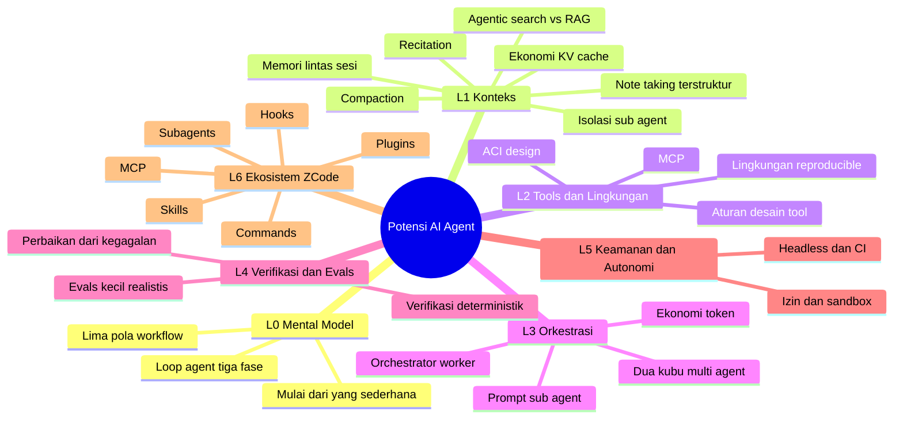
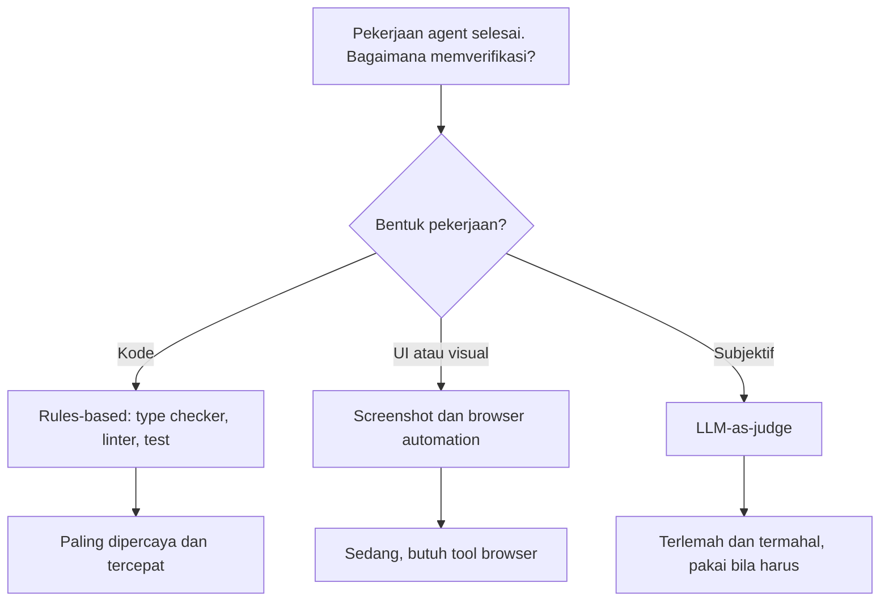

# Memaksimalkan Potensi AI Agent

Panduan lapangan untuk pengguna ZCode dan agent sejenis. Semua klaim disusun dari sumber primer terverifikasi: blog engineering Anthropic, Manus, Cognition, OpenAI, dan paper akademik (NeurIPS, arXiv). Tautan lengkap ada di bagian [Sumber](#8-sumber).

## Daftar Isi

1. [TL;DR](#1-tldr)
2. [Peta Besar](#2-peta-besar)
3. [Prasyarat: 10 Konsep Fondasi](#3-prasyarat-10-konsep-fondasi)
4. [Tujuh Lapisan Faktor](#4-tujuh-lapisan-faktor)
5. [Angka yang Layak Dihafal](#5-angka-yang-layak-dihafal)
6. [Urutan Belajar](#6-urutan-belajar)
7. [FAQ](#7-faq)
8. [Sumber](#8-sumber)

## Untuk Siapa Dokumen Ini

| Pembaca | Jalur baca | Estimasi waktu |
|---|---|---|
| Pemula yang baru mencoba agent | TL;DR, Peta Besar, Prasyarat, Urutan Belajar langkah 1-4 | sekitar 2 jam |
| Peneliti atau praktisi | TL;DR, Tujuh Lapisan, Angka, Sumber | sekitar 1 jam, lalu lanjut ke sumber primer |

---

## 1. TL;DR

> Potensi agent bukan fungsi dari satu lever, melainkan dari loop tertutup yang sehat: konteks yang dikurasi, tools yang dirancang untuk model, verifikasi yang deterministik, eval yang berbasis penggunaan nyata, lalu kembali ke konteks. AGENTS.md hanyalah titik masuk ke loop itu.

Seluruh peta faktor pada akhirnya melayani satu siklus kerja yang sama (Anthropic, [Building agents with the Claude Agent SDK](https://claude.com/blog/building-agents-with-the-claude-agent-sdk)):

```text
gather context  →  take action  →  verify work  →  repeat
```

Diagnosa setiap kegagalan agent dengan satu pertanyaan: fase mana yang gagal?

---

## 2. Peta Besar



Fallback tanpa renderer Mermaid:

<details>
<summary>Lihat versi ASCII</summary>

```text
POTENSI AI AGENT
│
├── L0 Mental Model
│   ├── Loop: gather → act → verify
│   └── Lima pola workflow, sederhana dulu
├── L1 Konteks
│   ├── Compaction dan note-taking
│   ├── Isolasi sub-agent
│   ├── Recitation dan simpan error
│   ├── KV-cache dan ekonomi token
│   ├── Agentic search vs RAG
│   └── Memori lintas sesi
├── L2 Tools dan Lingkungan
│   ├── ACI design (SWE-agent)
│   ├── Aturan desain tool
│   ├── MCP
│   └── Lingkungan reproducible
├── L3 Orkestrasi
│   ├── Orchestrator-worker
│   ├── Dua kubu: Anthropic vs Cognition
│   ├── Prompt sub-agent dan effort scaling
│   └── Ekonomi token orkestrasi
├── L4 Verifikasi dan Evals
│   ├── Verifikasi deterministik
│   ├── Evals kecil dan realistis
│   └── Loop perbaikan dari kegagalan
├── L5 Keamanan dan Autonomi
│   ├── Izin dan sandbox
│   └── Headless dan CI
└── L6 Ekosistem ZCode
    ├── Skills, Commands, Hooks
    ├── MCP, Subagents, Plugins
    └── AGENTS.md (satu lapis dari stack)
```

</details>

---

## 3. Prasyarat: 10 Konsep Fondasi

Kuasai urutan berikut, dan setiap faktor di bagian 4 akan terasa logis, bukan hafalan.

```text
1 Token dan context window ──┐
2 Non-determinisme ──────────┼─→ 5 Agent vs workflow ─→ 6 Loop dan harness ─→ SEMUA faktor
3 Attention dan KV-cache ────┘        │
4 Anatomi tools ──────────────────────┘─→ 7 MCP → 8-10 kosakata (baca sambil jalan)
```

| Istilah | Arti dalam satu kalimat | Sumber |
|---|---|---|
| Token dan context window | Semua yang model "tahu" dalam satu panggilan harus muat di jendela terbatas yang makin penuh makin buruk perhatiannya | [Effective Context Engineering](https://www.anthropic.com/engineering/effective-context-engineering-for-ai-agents) |
| Non-determinisme | Output model bervariasi antar panggilan, jadi instruksi teks adalah harapan bukan jaminan | [Building Effective Agents](https://www.anthropic.com/research/building-effective-agents) |
| Attention dan KV-cache | Perhatian model tak merata dan biaya dihitung via cache per prefiks, ini dasar recitation dan prefix stabil | [Manus](https://manus.im/blog/Context-Engineering-for-AI-Agents-Lessons-from-Building-Manus) |
| Tool use (function calling) | Model memutuskan kapan memanggil fungsi berformat JSON, software eksternal mengeksekusinya dan mengembalikan hasil | [Tool use docs](https://platform.claude.com/docs/en/agents-and-tools/tool-use/overview) |
| Agent vs workflow | Workflow diorkestrasi kode tetap; agent adalah LLM yang otonom menggunakan tools dalam loop dan mengarahkan prosesnya sendiri | [Building Effective Agents](https://www.anthropic.com/research/building-effective-agents) |
| Agent loop dan harness | Agent bekerja dalam siklus konteks, aksi, verifikasi; harness adalah infrastruktur di luar model yang menjalankan loop itu, dan ZCode adalah harness | [Claude Agent SDK](https://claude.com/blog/building-agents-with-the-claude-agent-sdk) |
| MCP | Standar terbuka sejak Nov 2024, metafora resminya "USB-C untuk AI", satu protokol untuk menyambung agent ke sistem eksternal | [modelcontextprotocol.io](https://modelcontextprotocol.io/docs/2026-07-28/getting-started/intro) |
| Kosakata retrieval | Embedding, chunk, RAG, BM25, reranker, dan bedanya dengan agentic search (grep bertingkat) | [Contextual Retrieval](https://www.anthropic.com/research/contextual-retrieval) |
| Progressive disclosure | Muat metadata dulu, isi penuh hanya saat relevan, detail on demand; dasar dari semua Skills | [Agent Skills](https://www.anthropic.com/research/equipping-agents-for-the-real-world-with-agent-skills) |
| Kosakata evaluasi | Ground truth, outcome vs trajectory, LLM-as-judge; dibutuhkan untuk membaca bagian verifikasi | [Demystifying Evals](https://www.anthropic.com/research/demystifying-evals-for-ai-agents) |

Jalur baca minimal: konsep 1, 2, 4, 5, 6 (sekitar 60 menit, semua gratis dan resmi), sisanya pelajari on demand.

---

## 4. Tujuh Lapisan Faktor

### L0: Mental Model

Agent = satu loop, tiga fase. Semua optimisasi melayani salah satu fasenya.

```text
gather context  →  take action  →  verify work  →  repeat
```

Lima pola bertingkat, dari paling sederhana (Anthropic, [Building Effective Agents](https://www.anthropic.com/research/building-effective-agents)):

| Pola | Inti | Kapan dipakai |
|---|---|---|
| Prompt chaining | Pecah tugas jadi substep tetap, tiap call memproses output sebelumnya | Tugas yang bisa diurutkan |
| Routing | Klasifikasikan input, arahkan ke jalur khusus | Ada beberapa jenis permintaan |
| Parallelization | Bagi tugas independen atau pakai voter dan checker | Tugas bisa dipecah bersih |
| Orchestrator-workers | LLM pusat mendistribusikan kerja secara dinamis lalu menyintesis | Tugas tak bisa dipetakan di depan |
| Evaluator-optimizer | Satu LLM menghasilkan, LLM lain menilai dan memberi umpan balik | Ada rubrik penilaian jelas |

Prinsip utama: mulai dari yang paling sederhana dan tambahkan kompleksitas hanya saat terbukti perlu. Pendapat yang sama dipegang OpenAI: single agent dulu, multi agent hanya jika data menuntut ([A Practical Guide to Building Agents](https://openai.com/business/guides-and-resources/a-practical-guide-to-building-ai-agents)).

### L1: Konteks

Konteks adalah sumber daya terbatas. Semua strategi berikut melayani kurasinya.

| Faktor | Inti praktik | Sumber |
|---|---|---|
| Compaction | Rangkum riwayat saat mendekati batas window agar agent bisa lanjut | [Context Engineering](https://www.anthropic.com/engineering/effective-context-engineering-for-ai-agents) |
| Note-taking terstruktur | Simpan rencana, state, fakta penting di file eksternal, baca ulang setelah reset | sumber sama |
| Isolasi sub-agent | Delegasi ke sub-agent ber-window bersih yang hanya mengembalikan ringkasan | sumber sama |
| Agentic search lebih utama dari RAG | Grep bertingkat lebih akurat, transparan, dan mudah dirawat daripada indeks embedding | [Claude Agent SDK](https://claude.com/blog/building-agents-with-the-claude-agent-sdk) |
| Repo map | Tree-sitter membangun graph referensi file, PageRank mengurutkan, tampil dalam budget token tetap | [Aider](https://aider.chat/2023/10/22/repomap.html) |
| Memori lintas sesi | File progres, feature list JSON, git history; setiap sesi baru bangun dan langsung bekerja | [Effective Harnesses](https://www.anthropic.com/research/effective-harnesses-for-long-running-agents) |
| Recitation | Tulis ulang tujuan di akhir konteks secara berkala, model memperhatikan yang dekat akhir window | [Manus](https://manus.im/blog/Context-Engineering-for-AI-Agents-Lessons-from-Building-Manus) |
| Simpan error di konteks | Jangan hapus kegagalan dari riwayat, model belajar dan tidak mengulanginya | sumber sama |
| Ekonomi KV-cache | Prefix stabil, konteks append-only, mask tool jangan remove | sumber sama |
| Contextual retrieval | Kalau memang butuh RAG: sisip konteks per chunk, kegagalan turun 49%, dengan reranker 67% | [Anthropic](https://www.anthropic.com/research/contextual-retrieval) |

> KV-cache hit rate adalah satu metrik yang paling menentukan performa agent. Cache hit versus miss beda biaya sekitar 10 kali. (Manus)

### L2: Tools dan Lingkungan (ACI)

> Dengan model yang sama, desain interface berbeda menghasilkan performa berbeda sampai level state of the art. Analog dengan HCI: HCI menentukan produktivitas manusia, ACI menentukan produktivitas agent. (SWE-agent, NeurIPS 2024, [arXiv 2405.15793](https://arxiv.org/abs/2405.15793))

Enam aturan desain tool (Anthropic, [Writing Tools for Agents](https://www.anthropic.com/engineering/writing-tools-for-agents)):

| Aturan | Contoh konkret |
|---|---|
| Konsolidasi sekitar workflow | Satu `schedule_event`, bukan empat tool terpisah; kebanyakan tool justru mengganggu |
| Interface seperti manusia | `search_contacts`, bukan dump seluruh daftar kontak |
| Response high-signal | Nama semantik bukan UUID, pesan error yang actionable, pagination dan truncation |
| Format respons fleksibel | Enum `concise` atau `detailed`; satu contoh memangkas token sampai sepertiga |
| Namespacing | `asana_projects_search`; posisi prefix versus suffix berdampak terukur |
| Evals untuk iterasi | Ukur akurasi, token, runtime; baca transcript reasoning agent |

Prinsip lingkungan dari [best practices](https://www.anthropic.com/research/claude-code-best-practices) dan [harness post](https://www.anthropic.com/research/effective-harnesses-for-long-running-agents):

| Komponen | Fungsi |
|---|---|
| Container atau devcontainer | Sandbox aman untuk mode otonom penuh |
| `init.sh` | Setup plus smoke test, menghemat token karena agent tak perlu menemukan ulang cara menjalankan app |
| `gh` CLI | Agent bisa membuat PR, membaca review, triage issue |
| Clean state | Repo siap merge tanpa pembersihan di setiap akhir sesi |

### L3: Orkestrasi

Dua kubu yang perlu Anda pahami sebelum memihak:

| Aspek | Anthropic (multi-agent research system) | Cognition (Don't Build Multi-Agents) |
|---|---|---|
| Posisi | Orchestrator-worker, 3-5 subagent paralel, tiap subagent 3+ tool paralel | Single agent, konteks penuh dibagi semua agent |
| Bukti | Menang 90.2% atas single-agent Opus di riset lebar, waktu riset turun sampai 90% | Aksi membawa keputusan implisit yang bertabrakan saat paralel |
| Kapan dipakai | Riset dan pencarian lebar di lautan data yang mostly-irrelevant | Pengeditan kode yang saling terkait |

Sintesis praktisnya kini berjalan ke arah itu; Cognition menindaklanjuti dengan [Multi-Agents: What's Actually Working](https://cognition.com/blog/multi-agents-working).

Deskripsi tugas sub-agent harus memuat empat elemen (kasus nyata: prompt kabur menyebabkan pekerjaan duplikat):

| Elemen | Isi |
|---|---|
| Objective | Tujuan tunggal yang jelas |
| Output format | Bentuk jawaban yang diharapkan |
| Tool guidance | Sumber dan tool yang boleh dipakai |
| Boundaries | Batasan eksplisit, apa yang jangan disentuh |

Aturan effort scaling dari sistem riset Anthropic:

| Kompleksitas tugas | Skala |
|---|---|
| Fakta sederhana | 1 agent, 3-10 tool call |
| Komparasi | 2-4 subagent, 10-15 call masing-masing |
| Riset kompleks | 10+ subagent |

> Agent memakai sekitar 4 kali token chat; sistem multi-agent 15 kali. Token usage sendirian menjelaskan 80% varians performa, bersama jumlah tool call dan pilihan model menjadi 95%. Hemat token bukan sekadar hemat biaya, ia adalah performa. (Anthropic)

### L4: Verifikasi dan Evals

Hierarki umpan balik, dari yang paling dipercaya (Anthropic, [Claude Agent SDK](https://claude.com/blog/building-agents-with-the-claude-agent-sdk)):



Prinsip eval yang terverifikasi ([Demystifying Evals](https://www.anthropic.com/research/demystifying-evals-for-ai-agents), [multi-agent system](https://www.anthropic.com/engineering/built-multi-agent-research-system)):

| Prinsip | Inti |
|---|---|
| Mulai kecil dan nyata | Sekitar 20 kasus penggunaan nyata; tweak awal mengangkat sukses dari 30% ke 80% |
| LLM-as-judge tunggal | Satu call skor 0.0-1.0 plus pass/fail, lebih konsisten dengan manusia daripada panel judge |
| Nilai outcome, bukan trajectory | Agent punya banyak jalur valid, nilai hasil dan kualitas proses bukan urutan langkah |
| Nilai end state | Untuk agent yang mengubah state, evaluasi kondisi akhir sistem |
| Human testing | Menangkap bias yang tak terlihat judge, contoh: preferensi content farm di atas PDF akademik |

Loop perbaikan diri dari analisis kegagalan ([checklist Agent SDK](https://claude.com/blog/building-agents-with-the-claude-agent-sdk)):

- [ ] Inspeksi output, terutama kegagalan
- [ ] Salah paham? Perbaiki struktur pencarian atau API agar info mudah ditemukan
- [ ] Gagal berulang? Tambahkan rule formal di tool call
- [ ] Tak bisa self-correct? Beri tool yang lebih berguna
- [ ] Kualitas drift saat fitur bertambah? Bangun eval set dari penggunaan nyata

Catatan penting dari harness post: agent cenderung overclaim. Claude menandai fitur selesai hanya dari unit test padahal bermasalah secara end to end. Karena itu verifikasi E2E (browser automation, "test as a human user would") wajib diinstruksikan eksplisit.

### L5: Keamanan dan Autonomi

| Praktik | Inti | Sumber |
|---|---|---|
| Allowlist terkurasi | Izin spesifik seperti `Edit` dan `Bash(git commit:*)` mempercepat siklus tanpa buka semua | [Best practices](https://www.anthropic.com/research/claude-code-best-practices) |
| Safe YOLO mode | Skip permissions hanya di container tanpa internet, untuk lint fix atau boilerplate | sumber sama |
| Guardrails | Pilar ketiga sejajar model dan orkestrasi, wajib untuk agensi berisiko | [OpenAI guide](https://openai.com/business/guides-and-resources/a-practical-guide-to-building-ai-agents) |
| Headless dan CI | Mode non-interaktif untuk triage issue, fan-out migrasi, pipeline antar command | sumber sama |

### L6: Ekosistem ZCode

Semua faktor abstrak di atas punya wujud konkret di ZCode (terverifikasi dari konfigurasi ZCode):

| Artefak | Fungsi | Lokasi |
|---|---|---|
| Skills | Pengetahuan prosedural on-demand, progressive disclosure 3 level, body di bawah 500 baris | `.zcode/skills/` atau `~/.zcode/skills/` |
| Commands | Workflow berulang jadi template `$ARGUMENTS`, bisa di-share ke tim via git | `.zcode/commands/` |
| Hooks | Determinisme di 7 event: SessionStart, UserPromptSubmit, PreToolUse, PermissionRequest, PostToolUse, PostToolUseFailure, Stop | `.zcode/config.json`, wajib `hooks.enabled: true` |
| MCP | Integrasi eksternal terstandar, auto-connect di kedua scope | `mcp.servers` di config |
| Subagents | Konteks terisolasi plus spesialisasi per domain | `.zcode/agents/*.md` |
| Plugins | Distribusi paket berisi semua di atas, dari marketplace | Settings, Plugin Management |
| AGENTS.md | Satu lapis dari stack ini, dua scope: user dan workspace | `~/.zcode/AGENTS.md` plus `<repo>/AGENTS.md` |

---

## 5. Angka yang Layak Dihafal

| Angka | Arti | Sumber |
|---|---|---|
| ~10x | Beda biaya cache miss versus hit | Manus |
| 4x / 15x | Token agent versus chat; multi-agent versus chat | Anthropic multi-agent |
| 80% / 95% | Varians performa dijelaskan token; ditambah tool call dan pilihan model | Anthropic multi-agent |
| 90.2% | Menang multi-agent atas single-agent Opus untuk riset lebar | Anthropic multi-agent |
| 90% | Penghematan waktu riset dari paralelisme 3-5 subagent | Anthropic multi-agent |
| 40% | Perbaikan dari deskripsi tool yang ditulis ulang | Anthropic multi-agent |
| 30% ke 80% | Success rate dengan sekitar 20 eval kasus nyata | Anthropic multi-agent |
| 49% / 67% | Penurunan kegagalan retrieval contextual retrieval, dengan reranker | Anthropic |
| < 500 baris | Budget isi SKILL.md | Claude docs |

---

## 6. Urutan Belajar

- [ ] 1. [Building Effective Agents](https://www.anthropic.com/research/building-effective-agents) (30 menit): mental model dan lima pola
- [ ] 2. [Claude Code Best Practices](https://www.anthropic.com/research/claude-code-best-practices) (30 menit): praktik harian, terapkan langsung di ZCode
- [ ] 3. [Effective Context Engineering](https://www.anthropic.com/engineering/effective-context-engineering-for-ai-agents) plus [Manus](https://manus.im/blog/Context-Engineering-for-AI-Agents-Lessons-from-Building-Manus) (45 menit): disiplin konteks dari dua sudut pandang
- [ ] 4. [Writing Tools for Agents](https://www.anthropic.com/engineering/writing-tools-for-agents) plus [paper SWE-agent](https://arxiv.org/abs/2405.15793) (45 menit): desain ACI, teori plus bukti
- [ ] 5. [Agent Skills](https://www.anthropic.com/research/equipping-agents-for-the-real-world-with-agent-skills) plus konfigurasi ZCode (30 menit): implementasi di ZCode
- [ ] 6. [Multi-agent research system](https://www.anthropic.com/engineering/built-multi-agent-research-system) versus [Don't Build Multi-Agents](https://cognition.com/blog/dont-build-multi-agents) (45 menit): dua kubu orkestrasi
- [ ] 7. [Effective harnesses](https://www.anthropic.com/research/effective-harnesses-for-long-running-agents) plus [Demystifying Evals](https://www.anthropic.com/research/demystifying-evals-for-ai-agents) (45 menit): tahap produksi dan otonom penuh
- [ ] 8. Fondasi akademik (opsional): [ReAct](https://arxiv.org/abs/2210.03629), [Reflexion](https://arxiv.org/abs/2303.11366), [MemGPT](https://arxiv.org/abs/2310.08560), [METR](https://arxiv.org/abs/2503.14499)

---

## 7. FAQ

<details>
<summary>Kapan saya perlu multi-agent?</summary>

Untuk pencarian dan riset lebar di lautan data yang mostly-irrelevant (multi-agent Anthropic menang 90.2% di kasus ini). Untuk pengeditan kode yang saling terkait, single agent dengan konteks penuh lebih aman karena aksi membawa keputusan implisit yang bertabrakan saat paralel (Cognition). Kalau masih ragu, mulai single agent dulu dan tambahkan kompleksitas hanya saat data menuntut.
</details>

<details>
<summary>RAG atau agentic search?</summary>

Default: agentic search (grep dan navigasi bertingkat). Pencarian semantik lebih cepat tapi kurang akurat, lebih sulit dirawat, dan tidak transparan (Claude Agent SDK). Tambahkan embedding hanya jika Anda butuh kecepatan atau variasi frasa besar. Kalau sudah benar-benar butuh RAG, pakai contextual retrieval untuk menurunkan kegagalan retrieval sampai 67%.
</details>

<details>
<summary>Kenapa hooks lebih dipercaya daripada prompt?</summary>

Karena instruksi teks adalah harapan dan model non-deterministik, sedangkan hook adalah kode deterministik yang berjalan pada event tertentu (7 event di ZCode). Pola umum: apa pun yang bisa diverifikasi mesin sebaiknya dieksekusi mesin, bukan diminta lewat prompt. Prompt tetap berperan untuk hal yang tidak bisa diverifikasi mesin.
</details>

<details>
<summary>Mulai dari mana hari ini?</summary>

Tiga langkah pertama Urutan Belajar, lalu langsung praktek di ZCode: buat satu skill, satu slash command, dan satu hook kecil. Artefak kecil yang jalan memberi pemahaman lebih cepat daripada membaca sepuluh artikel.
</details>

---

## 8. Sumber

### Anthropic (engineering dan research)

- [Claude Code: Best practices for agentic coding](https://www.anthropic.com/research/claude-code-best-practices)
- [Building Effective Agents](https://www.anthropic.com/research/building-effective-agents)
- [Effective Context Engineering for AI Agents](https://www.anthropic.com/engineering/effective-context-engineering-for-ai-agents)
- [Equipping agents for the real world with Agent Skills](https://www.anthropic.com/research/equipping-agents-for-the-real-world-with-agent-skills)
- [Writing Tools for Agents](https://www.anthropic.com/engineering/writing-tools-for-agents)
- [How we built our multi-agent research system](https://www.anthropic.com/engineering/built-multi-agent-research-system)
- [Effective harnesses for long-running agents](https://www.anthropic.com/research/effective-harnesses-for-long-running-agents)
- [Building agents with the Claude Agent SDK](https://claude.com/blog/building-agents-with-the-claude-agent-sdk)
- [Contextual Retrieval](https://www.anthropic.com/research/contextual-retrieval)
- [Demystifying Evals for AI Agents](https://www.anthropic.com/research/demystifying-evals-for-ai-agents)
- [Introducing the Model Context Protocol](https://www.anthropic.com/news/model-context-protocol)

### Sumber lain

- [Context Engineering: Lessons from Building Manus](https://manus.im/blog/Context-Engineering-for-AI-Agents-Lessons-from-Building-Manus)
- [Don't Build Multi-Agents (Cognition)](https://cognition.com/blog/dont-build-multi-agents)
- [Multi-Agents: What's Actually Working (Cognition)](https://cognition.com/blog/multi-agents-working)
- [A Practical Guide to Building Agents (OpenAI)](https://openai.com/business/guides-and-resources/a-practical-guide-to-building-ai-agents)
- [Building a better repository map with tree sitter (Aider)](https://aider.chat/2023/10/22/repomap.html)
- [Agent Skills open standard](https://agentskills.io/home)
- [What is MCP (modelcontextprotocol.io)](https://modelcontextprotocol.io/docs/2026-07-28/getting-started/intro)
- [Tool use with Claude (Claude Platform Docs)](https://platform.claude.com/docs/en/agents-and-tools/tool-use/overview)
- [Context engineering cookbook (Claude Platform)](https://platform.claude.com/cookbook/tool-use-context-engineering-context-engineering-tools)
- [Skill authoring best practices (Claude Platform Docs)](https://platform.claude.com/docs/en/agents-and-tools/agent-skills/best-practices)

### Paper akademik

- [SWE-agent: Agent-Computer Interfaces Enable Automated Software Engineering (NeurIPS 2024)](https://arxiv.org/abs/2405.15793)
- [ReAct: Synergizing Reasoning and Acting in Language Models (ICLR 2023)](https://arxiv.org/abs/2210.03629)
- [Reflexion: Language Agents with Verbal Reinforcement Learning (NeurIPS 2023)](https://arxiv.org/abs/2303.11366)
- [MemGPT: Towards LLMs as Operating Systems](https://arxiv.org/abs/2310.08560)
- [Measuring AI Ability to Complete Long Tasks (METR)](https://arxiv.org/abs/2503.14499)
